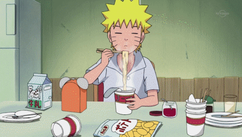

# Привет 👋

 
 
 

# Обо мне 💬 :

### - Мне 22. Занимаюсь разработкой на платформе Android, но на данный момент преподаю в академии Топ.
### - Преподаватель РПО (Разработка программного обеспечения) Python, Основы программирования на языке С++, Объектно-ориентированное программирование с использованием языка C++

### - Изучал :
- ✨ Разработка приложений на Android
- ✨ Разработка мультиплатформенных приложений с помощью kotlin multiplatform mobile
- ✨ Разработка информационных систем

### - Хобби : 
- ✨ Компьютерные игры
- ✨ Бильярд

 
 
 

# Языки & Инструменты 👨‍💻 🛠:
 

<!-- For more icons please follow  https://github.com/MikeCodesDotNET/ColoredBadges -->

 

 
 
 

# Контакты :

  

Если вы хотите обратиться ко мне по любому поводу 😉.

 
 
 
</a>

 

*************
